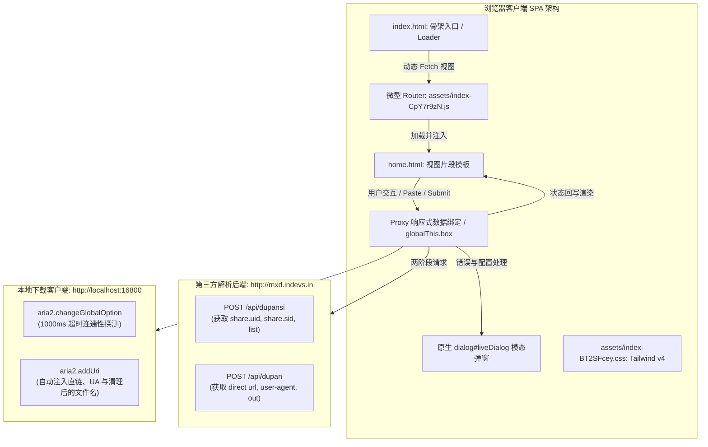

# Repository Guidelines

本文档为当前仓库的 AI 助手与开发者指引手册，旨在提供全景架构认知、数据链路规范、代码设计模式、关键运行时配置以及自动化测试与验证工作流。

---

## Project Overview

本仓库是一个**纯前端单页（SPA）静态应用**，实现百度网盘无损直链解析与本地高速下载（Baidu Netdisk Link Resolver & Aria2/Motrix Downloader）。

### 核心功能与业务定位
- **双阶段直链解析**：用户输入转存后的百度网盘分享链接与提取码，前端两步调用第三方后端 API（解析分享元数据 `/api/dupansi`，提取真实下载直链 `/api/dupan`）。
- **Aria2 / Motrix 自动化推送**：解析完成后自动调用本地运行的 Motrix 或 Aria2 客户端 JSON-RPC 接口（`aria2.addUri`），实现多线程高速直链下载，无需手动复制直链或配置 User-Agent。
- **声明式微型前端架构**：基于轻量原生 JavaScript 实现自研 SPA 微路由器（微型 Router）、响应式数据绑定代理（Proxy Data Binding）以及基于原生 `<dialog>` 的交互系统，无重型 UI 框架开销。

### 业务与运维约束
- **必须先转存再分享**：不支持直接解析他人原始分享链接，用户须先转存至自己网盘并创建分享。
- **仅支持顶层文件**：后端接口仅遍历分享链接根目录的文件；**所有子目录及其内部文件会被直接忽略**。
- **`sign` 与 `uid` 临时绑定**：每次解析使用 32 位强随机字符串 `sign`（保存在 `localStorage.sign`），服务端将其与用户的百度 `uid` 临时绑定，**每小时自动刷新解绑**。若一个小时内 `sign` 冲突或更换了 `uid`，解析将返回失败。
- **频次配额限制**：服务端限制每个标识每小时大约解析 **5 个任意大小文件**（在 `home.html` 顶部提示）。

---

## Architecture & Data Flow

### 高层架构拓扑



### 关键模块职责划分 (`assets/index-CpY7r9zN.js`)

1. **`modulepreload` Polyfill**：检测浏览器是否支持原生模块预加载，不支持时通过 `MutationObserver` 监听 `<link rel="modulepreload">` 并使用 `fetch()` 预拉取。
2. **通用工具库 `e`**：
   - `e.random(len=16)`：基于 Web Crypto API（`crypto.getRandomValues`）生成 32 字符的十六进制随机签名。
   - `e.fixpath(str)`：正则清洗文件名非法字符 `[:*?"<>|]`，并将连续斜杠 `//+` 替换为单斜杠。
   - `e.xbody(form)`：表单数据抽取，将 `FormData` 转化为纯 JavaScript 对象并转换 Checkbox 为 `0/1`。
   - `e.tpl(template, data)`：轻量模板引擎，通过正则 `/[([a-z]{2,12})]/g` 替换 `[field]` 占位符。
   - `e.dialog(content)` / `e.xdialog()`：基于原生 `<dialog id="liveDialog">` 封装的居中模态弹窗系统，支持点击背景遮罩层自动关闭。
   - `e.save(key, val)` / `e.load(key, default)`：封装 `localStorage` 的 JSON 序列化存储。
3. **微型路由器类 `t`**：
   - 构造时根据 `document.body.dataset.site` 解析基路径，读取当前 `location.pathname` 中的页面标识（默认回退到 `'home'`）。
   - 执行 `fetch('${this.site}${page}.html')` 拉取 HTML 片段，若片段不含 `</html>` 则替换 `<main>` 内容，并调用 `n.page[page]?.()` 初始化生命周期钩子。
   - 代理 `document.body` 点击事件，拦截同源链接实现无刷新 SPA 页面切换。
4. **响应式状态代理 `r = new Proxy(n.data, ...)` 与全局上下文 `n`**：
   - 将内部上下文注入到 `globalThis.box = n` 便于调试。
   - `Proxy` 拦截数据变更，自动查找匹配的 `[data-json="${prop}"]` 元素，通过 `e.tpl` 重绘 DOM 节点。
   - `n.wait` 统一管理网络提交状态，自动切换按钮内图标为 `bi-arrow-clockwise animate-spin` 并防止重复提交。

### 业务端到端数据流

```
1. 用户在 input[name=url] 中粘贴百度网盘分享链接
   │
   ├─► [Paste 事件触发]
   │   - 过滤非 ASCII 字符，通过 cut('/s/1', '?') 提取短链 surl 与 pwd
   │   - 自动回填表单并存储到会话上下文 n.si = { surl, pwd }
   │
2. 用户点击 button[name=dupan]「打开」按钮
   │
   ├─► [第一阶段请求: /api/dupansi]
   │   - 读取或生成 localStorage.sign (32 位 Hex)，读取 location.hostname 作为 site
   │   - POST http://mxd.indevs.in/api/dupansi
   │     Body: { sign, site, surl, pwd }
   │   - 获取响应: { code: 0, share: { uid, sid }, list: [ { fid, name, size } ] }
   │   - 更新会话上下文 n.si = { ...n.si, uid, sid }
   │   - 设置 r.files = list -> 响应式触发 tbody[data-json="files"] 表格重绘
   │
3. 用户在表格中点击目标文件行 `<td data-fid="...">`
   │
   ├─► [Motrix RPC 连通性预检]
   │   - POST http://localhost:16800/jsonrpc (指令: aria2.changeGlobalOption, 超时: 1000ms)
   │   - 若失败: 弹出 e.dialog 提示 "Motrix 连接失败，请检查是否启动或右键点击「打开」配置 RPC"
   │   - 若成功: 行内下载图标变为转圈动画，准备拉取直链
   │
4. 前端发起第二阶段直链请求
   │
   ├─► [第二阶段请求: /api/dupan]
   │   - POST http://mxd.indevs.in/api/dupan
   │     Body: { sign, site, surl, pwd, uid, sid, fid }
   │   - 获取响应: { code: 0, data: { url: [ "https://..." ], info: { out, "user-agent": "netdisk" } } }
   │
5. 推送下载任务至本地 Aria2 / Motrix
   │
   └─► [JSON-RPC 指令: aria2.addUri]
       - a.out = e.fixpath(a.out) (过滤非法文件名字符)
       - POST http://localhost:16800/jsonrpc
         Payload: {
           "id": e.uid(),
           "method": "aria2.addUri",
           "params": [
             "token:" + n.aria2.token,
             [ data.url[0] ],
             { "out": a.out, "user-agent": "netdisk" }
           ]
         }
       - Motrix 接管下载任务，复位按钮转圈状态
```

---

## Key Directories

```
.
├── index.html                   # SPA 主入口，包含 HTML 骨架、加载动画、Bootstrap Icons 引入
├── home.html                    # 首页视图模板，包含分享链接表单与文件列表响应式表格
├── read.md                      # 百度网盘第三方解析后端 API 协议文档
├── AGENTS.md                    # 本文档：仓库全局架构、开发与 AI 协作规范
└── assets/                      # 编译后的静态发布资源目录
    ├── index-CpY7r9zN.js        # 核心前端应用脚本（微路由、响应式代理、API 调用、Aria2 RPC）
    └── index-BT2SFcey.css       # 全局样式表（基于 Tailwind CSS v4.3.3 编译）
```

---

## Development Commands

本项目为预构建的静态站点，**无法直接双击以 `file:///` 协议运行**（因 ES 模块跨域与动态 `fetch('home.html')` 限制），必须通过静态 HTTP 服务器托管运行。

### 1. 本地预览服务器启动命令

```bash
# 方式 A：Node.js (serve) - 推荐
npx serve . -p 8080

# 方式 B：Python 3 内置静态服务（零依赖）
python -m http.server 8080

# 方式 C：Bun 高性能托管
bun x serve . -p 8080

# 方式 D：http-server（禁用浏览器缓存）
npx http-server . -p 8080 -c-1
```
服务启动后，浏览器访问：`http://localhost:8080/index.html`。

### 2. 控制台动态调试指令
代码在初始化时将全局上下文单例暴露给 `window.box`（即 `globalThis.box`）。在浏览器 F12 控制台中可直接执行以下命令辅助调试：

```javascript
// 查看当前内部状态与会话参数
console.log(window.box.si);
console.log(window.box.aria2);

// 动态将后端接口重定向至本地 Mock 服务器
window.box.home = "http://localhost:3000";

// 手动注入文件列表，即时验证表格渲染样式
window.box.data.files = [
  { fid: "1001", name: "测试文档.pdf", size: "12.50" },
  { fid: "1002", name: "演示视频.mp4", size: "2048.00" }
];

// 测试 Motrix RPC 连接配置
window.box.aria2.jsonrpc = "http://127.0.0.1:16800/jsonrpc";
window.box.aria2.token = "my_secret_token";
```

---

## Code Conventions & Common Patterns

### 1. 编码风格与语法习惯
- **现代化原生 ES2022+**：重度使用可选链（`?.`）、空值合并（`??=`）、解构赋值、对象简写与箭头函数。
- **极简紧凑命名**：工具类与高频方法采用短命名（如 `e.uid`, `e.now`, `e.cut`, `e.tpl`, `e.xbody`）。
- **零外部 UI 框架依赖**：所有 DOM 变更均基于原生 Web API（`Proxy`, `MutationObserver`, `IntersectionObserver`, `<dialog>`, `HTMLTemplateElement`, `FormData`）。

### 2. DOM 数据绑定与模板约定
- **模板占位符语法**：使用 `[fieldName]` 格式（正则 `/[([a-z]{2,12})]/g`）。例如在 `home.html` 中：
  ```html
  <tbody class="font-mono" data-json="files">
    <tr>
      <td class="text-right">[size]<i class="ml-[2px]">MB</i></td>
      <td><i class="bi-download"></i></td>
      <td class="text-left px-0" data-fid="[fid]">[name]</td>
    </tr>
  </tbody>
  ```
- **自动驱动**：给 `window.box.data.files` 赋新数组时，`Proxy` 自动匹配 `[data-json="files"]` 并完成模板渲染。

### 3. 错误处理与用户交互约定
- **统一 Promise 捕获**：网络请求均包装 `.catch(e => ({ code: 1, message: e.message }))`，避免未捕获异常中断主链路。
- **统一模态反馈**：所有业务报错与配置提示统一调用 `e.dialog(message)`。该方法动态挂载居中 `<dialog id="liveDialog">`，换行符 `\n` 会自动转为 `<br>` 换行展示。
- **Motrix 离线友好拦截**：下载前必须先对本地 RPC 执行 1000ms 超时预检，若连通失败则阻断请求，引导用户排查 Motrix 运行状态。

### 4. 状态持久化与 LocalStorage 规范
| Key | 类型 | 结构 / 示例 | 说明 |
|---|---|---|---|
| `sign` | `string` | `"d41d8cd98f00b204e9800998ecf8427e"` | 客户端 32 位 Hex 唯一凭证，用于服务端频次控制 |
| `aria2` | `object` | `{"token":"","jsonrpc":"http://localhost:16800/jsonrpc"}` | 本地 Aria2 / Motrix RPC 地址及访问密钥 |

---

## Important Files

| 文件路径 | 职责与关键符号 |
|---|---|
| `index.html` | **SPA 骨架入口**。包含 `<body data-site="">`（用于二级子路径部署）、`<main class="max-w-2xl mx-auto">` 挂载点、CSS 旋转 Loader 以及 Bootstrap Icons CDN。 |
| `home.html` | **首页视图模板**。包含百度网盘解析搜索表单 `form.search`、提取码输入框、打开按钮 `button[name=dupan]`、以及带 `data-json="files"` 的文件列表行模板。 |
| `read.md` | **解析接口规范文档**。详细记录 `/api/dupansi` 与 `/api/dupan` 的参数字段、返回结构、使用说明与常见错误码。注意：文档中 2.2 节的 `http://mxd.index.in` 属笔误，前端真实请求为 `http://mxd.indevs.in`。 |
| `assets/index-CpY7r9zN.js` | **核心打包脚本 (Vite / ESM)**。内置原生 SPA 微路由类 `t`、工具库 `e`、响应式代理 `r`、全局状态 `n`（挂载至 `globalThis.box`）、Aria2 JSON-RPC 客户端集成。 |
| `assets/index-BT2SFcey.css` | **样式表**。基于 Tailwind CSS v4.3.3 构建，包含等宽字体 `font-mono`、模态弹窗 `#liveDialog` 样式、极简表格 `table.simple`、旋转动画 `.animate-spin`。 |

---

## Runtime & Tooling Preferences

### 1. 产物性质与开发注意事项
- 当前仓库为**预编译打包后的静态发布包（Distribution Bundle）**，不包含未编译的源码目录（如 `src/`）或包管理器锁定文件（如 `package.json`）。
- **维护与编辑模式**：
  - 对前端界面、文本提示与布局结构的修改，可直接安全编辑 `home.html` 与 `index.html`。
  - 对核心逻辑（如 API 地址、下载流程、超时设置）的修改，应直接对 `assets/index-CpY7r9zN.js` 进行精确修改，并保持语法一致性。

### 2. 服务器托管与路由配置禁忌
在配置 Nginx、Caddy 或 Apache 等 Web 服务器托管本仓库时：
- **切勿配置单页兜底重写（SPA Fallback）**：例如不能使用 `try_files $uri $uri/ /index.html;`。
- **原因**：微路由通过 `fetch('${page}.html')` 动态加载片段，并在代码中显式检查：
  ```javascript
  if (!htmlContent.includes('</html>')) {
    document.querySelector('main').innerHTML = htmlContent;
  }
  ```
  如果将 404 路径重写回 `index.html`，返回内容包含 `</html>`，路由系统将静默忽略并导致主视图空白。

### 3. 跨域与网络通信要求
- **Mixed Content（混合内容）防护**：生产环境若通过 `https://` 部署，浏览器会直接阻止页面向 `http://mxd.indevs.in`（HTTP 协议）发起请求。如需支持 HTTPS，必须在前端服务器配置反向代理（如 `/api/ -> http://mxd.indevs.in/api/`）。
- **Aria2 本地通信**：Motrix 客户端默认监听 `127.0.0.1:16800`，需确保系统防火墙未阻止本地环回跨域请求。

---

## Testing & QA

### 1. 当前测试现状
- 仓库内**暂无预设的自动化测试套件**（无 Jest、Vitest、Playwright 配置）。
- 质量保证主要依赖**本地 Web 托管手动走查**与**网络接口 Mock 验证**。

### 2. 本地手动走查验证清单

| 检查项 | 验证操作 | 预期结果 |
|---|---|---|
| **页面初次加载** | 启动 HTTP 服务访问 `http://localhost:8080` | 内联 Loader 旋转片刻后消失，`home.html` 成功渲染显示搜索表单与空表格 |
| **链接粘贴识别** | 在输入框粘贴 `https://pan.baidu.com/s/1xxxx 提取码: abcd` | 正则自动提取短链 `xxxx` 填入 URL 框，提取码 `abcd` 填入密码框 |
| **Aria2 配置弹窗** | 在「打开」按钮上点击**鼠标右键** (`contextmenu`) | 弹出原生配置弹窗，允许输入 RPC 地址与 Token；点击提交后写入 `localStorage.aria2` |
| **Motrix 离线拦截** | 确保本地未启动 Motrix，点击文件列表任意项 | 1 秒内弹出提示："Motrix 连接失败：1. 检查 Motrix 是否启动；2. 右键点击「打开」检查配置" |
| **错误分享链接处理** | 输入无效的百度分享链接并点击打开 | 解析按钮显示转圈动画，接口返回错误后弹出弹窗提示服务端具体错误信息 |

### 3. 自动化 Mock 测试方案 (Playwright / Puppeteer 示例)
在无公网网络或无 Motrix 客户端的环境下，可通过 Playwright 拦截路由实现端到端自动化验证：

```javascript
// e2e.test.js
import { test, expect } from '@playwright/test';

test('完整解析与下载推送链路走查', async ({ page }) => {
  // 1. Mock 第三方分享解析接口
  await page.route('http://mxd.indevs.in/api/dupansi', route => {
    route.fulfill({
      status: 200,
      contentType: 'application/json',
      body: JSON.stringify({
        code: 0,
        share: { uid: "mock_user_1", sid: "mock_share_2" },
        list: [
          { fid: "file_001", name: "QA_Test_Video.mp4", size: "1024" }
        ]
      })
    });
  });

  // 2. Mock 第三方直链解析接口
  await page.route('http://mxd.indevs.in/api/dupan', route => {
    route.fulfill({
      status: 200,
      contentType: 'application/json',
      body: JSON.stringify({
        code: 0,
        data: {
          url: ["https://d.pcs.baidu.com/file/mock_download_url"],
          info: { out: "QA_Test_Video.mp4", "user-agent": "netdisk" }
        }
      })
    });
  });

  // 3. Mock 本地 Motrix / Aria2 JSON-RPC
  await page.route('http://localhost:16800/jsonrpc', route => {
    const data = route.request().postDataJSON();
    if (data.method === 'aria2.changeGlobalOption') {
      route.fulfill({ status: 200, contentType: 'application/json', body: JSON.stringify({ result: 'OK' }) });
    } else if (data.method === 'aria2.addUri') {
      route.fulfill({ status: 200, contentType: 'application/json', body: JSON.stringify({ result: 'mock_gid_12345' }) });
    }
  });

  // 4. 执行业务测试流程
  await page.goto('http://localhost:8080/index.html');
  await page.fill('input[name=url]', 'https://pan.baidu.com/s/1mock_share_key');
  await page.fill('input[name=pwd]', '1234');
  await page.click('button[name=dupan]');

  // 验证表格成功展示文件
  const cell = page.locator('td[data-fid="file_001"]');
  await expect(cell).toHaveText('QA_Test_Video.mp4');

  // 触发下载
  await cell.click();
});
```

### 4. 重点边界与异常用例
1. **空链接 / 非百度网盘链接**：点击解析按钮，必须被前置正则 `startsWith('https://pan.baidu.com/s/')` 拦截，不得触发无效请求。
2. **带密码与不带密码分享**：验证 URL 查询参数中的 `?pwd=` 与独立文本框中密码的优先级与合并逻辑。
3. **文件名非法字符清洗**：后端返回的 `info.out` 若包含 Windows/Unix 非法字符（如 `demo:*?"<>|.mp4`），必须验证 `e.fixpath()` 正确剔除，避免 Aria2 落地文件报错。
4. **配额超限处理**：当服务端返回 `code !== 0`（如频次超限、提取码失效）时，页面必须优雅展示弹窗信息并复位按钮状态。
